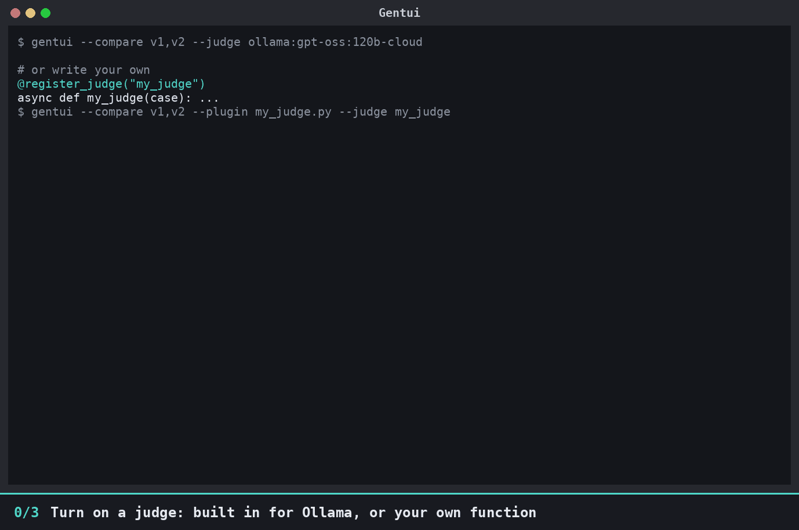

# Judges: score how well two runs match



In the compare view, the **Judge** drop-down turns a judge on. Each prompt's section then opens with a boxed **Judge panel**: a match score
(0 to 100%) with a bar, and the judge's comment on the key difference. The box is green from 80%, yellow from 50% and red
below; the summary shows the average. Prompts whose answers and tool calls are
identical score 100% without calling the judge. `--judge NAME` switches one on at start.

Gentui ships a judge for [Ollama](https://ollama.com), named `ollama:<model>`. Any model works after the colon:

```bash
# a "-cloud" model goes through your local Ollama, which forwards it to Ollama Cloud (run `ollama signin` once, no key)
gentui --compare v1,v2 --judge ollama:gpt-oss:120b-cloud

# straight to ollama.com with an API key (ollama.com/settings/keys); default model gpt-oss:120b
export OLLAMA_API_KEY=...
gentui --compare v1,v2 --judge ollama
GENTUI_JUDGE_MODEL=deepseek-v3.1:671b gentui --compare v1,v2 --judge ollama

# a model on your local Ollama needs no key
gentui --compare v1,v2 --judge ollama:qwen3:8b
```

`OLLAMA_HOST` points it at another server (it overrides the above).

To bring your own judge, write a plugin and load it with `--plugin`:

```python
# my_judge.py
from gentui.plugins import register_judge

@register_judge("mine")
async def mine(case):          # sync works too
    # case.prompt, case.left, case.right (the answers as text),
    # case.left_tools, case.right_tools ([{"name", "args", "result"}])
    return {"score": 0.8, "reason": "same facts, B leaves out the disk threshold"}
```

```bash
gentui --compare v1,v2 --plugin my_judge.py --judge mine
```

Return `{"score": 0..1, "reason": "..."}` (or a `(score, reason)` tuple). A judge that raises shows "judge failed" on that
prompt and nothing else is affected. Verdicts are cached in `~/.cache/gentui/judge.json`, keyed by the judge and both
answers, so judging the same pair again is instant and free. If you change a judge's logic but keep its name, rename it
(or delete the cache file) so old verdicts are not reused.

## Example judges

[`examples/judges/`](https://github.com/rahrajlat/Gentui/tree/main/examples/judges) has three ready-made judges to copy from:

| File | Judge name | What it does | Needs |
|---|---|---|---|
| `same_numbers.py` | `same-numbers` | share of numbers that appear in both answers | nothing |
| `same_tools.py` | `same-tools` | same tool calls, same arguments, same order? | nothing |
| `strands_judge.py` | `strands` | a Strands agent (an LLM) returns a structured verdict | `gentui[strands,harness,ollama]` and Ollama |

Try them on the sample recordings in `examples/compare/`:

```bash
# one judge
gentui --compare examples/compare/v1,examples/compare/v2 --plugin examples/judges/same_numbers.py --judge same-numbers

# several plugins at once; pick the judge in the Judge drop-down (or with --judge)
gentui --compare examples/compare/v1,examples/compare/v2 \
  -p examples/judges/same_numbers.py -p examples/judges/same_tools.py --judge same-tools

# write the HTML report without opening the UI
gentui --compare examples/compare/v1,examples/compare/v2 -p examples/judges/same_tools.py \
  --judge same-tools --export report.html
```

**Privacy:** a judge is sent the prompt, the answers and the tool output. With a hosted judge that leaves your machine, and
recordings can contain secrets. Judging only happens when you turn a judge on.
